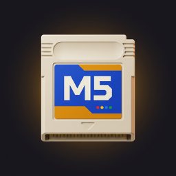
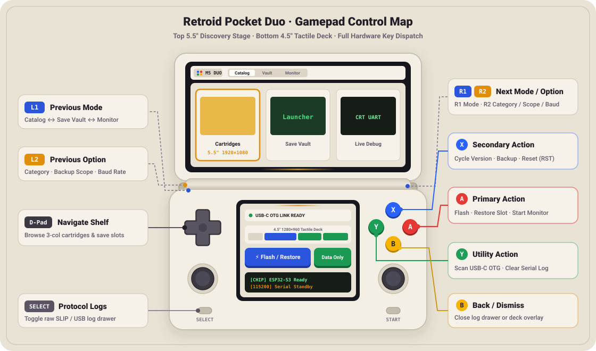

<p align="center">
  
</p>

<h1 align="center">M5Burner Duo</h1>

<p align="center">
  <b>Native Dual-Screen Android M5Stack Online Flasher, Backup Vault & Serial Monitor</b><br/>
  Purpose-built for the <b>Retroid Pocket Duo</b> clamshell handheld.
</p>

<p align="center">
  <b>English</b> | <a href="README_CN.md">简体中文</a>
</p>

<p align="center">
  <a href="https://github.com/sky18Dragon/M5bunberDuo/releases/latest">
    
  </a>
</p>

---

## Download & Install

1. Open the [**GitHub Releases**](https://github.com/sky18Dragon/M5bunberDuo/releases/latest) page directly on your **Retroid Pocket Duo** (or on a PC) and download the latest `M5BurnerDuo-v*.apk`.
2. **Direct install on Retroid Pocket Duo**: Tap the downloaded `.apk` in the Files app and allow installing from unknown sources if prompted.
3. **Install via ADB (optional)**:
   ```bash
   adb install -r M5BurnerDuo-v1.0.0.apk
   ```
4. Connect any M5Stack device to the Retroid Pocket Duo's USB-C port with a data-capable USB-C cable (or OTG adapter) and grant USB permission when prompted.

---

## Overview

**M5Burner Duo** brings the online firmware ecosystem of [burner.m5stack.com](https://burner.m5stack.com/) to a native, PC-free Android handheld experience. Because mobile browsers do not support WebSerial, M5Burner Duo implements the Espressif ESP32 ROM bootloader & flasher stub SLIP protocol directly in pure Kotlin over Android USB-C OTG.

Designed around human-centered dual-screen ergonomics in a **Retro Handheld Console** style (SFC Warm Beige in Light Mode, Warm CRT Obsidian in Dark Mode — automatically following the Android system theme):

- **Top Screen (5.5" 1920 × 1080, 16:9, 120Hz) — Observation & Discovery Plane**: Full-screen immersive browsing of community firmwares, save-slot backups, and high-readability phosphor CRT serial logs.
- **Bottom Screen (4.5" 1280 × 960, 4:3, 120Hz) — Tactile Control Deck**: Automatically rendered via Android `DisplayManager` + `Presentation` (with seamless single-screen overlay fallback), putting thumb-friendly 3D push-buttons, live hardware link status, and a real-time Flash Memory Map right between your thumbs.

---

## Core Features

### 1. Firmware Cartridges (Online Discovery & Flashing)
- Connects directly to the live M5Burner catalog (`m5burner-api.m5stack.com`) and binary CDN (`m5burner-cdn.m5stack.com`) with local JSON & `.bin` caching.
- Filter by M5Stack device family (Cardputer, StickC / Plus2, StickS3, Core, Core2 & Tough, CoreS3, Atom, AtomS3, Paper, Dial, Tab5, NanoC6, etc.), search, sort, and switch firmware versions.
- High-speed **zlib-compressed flashing** (`FLASH_DEFL_*`), configurable baud rates (`115200`–`1500000`), custom offsets (`0x0` / `0x10000`), 4MB flash erase, and hardware auto-reset.

### 2. Save-Slot Vault (Firmware & User Data Backup / Restore)
- **Auto Full-Chip Backup (Default)**: Probes the bootloader header and `0x8000` partition table to auto-detect real SPI Flash capacity (4MB / 8MB / 16MB), capturing **App firmware + NVS config + LittleFS / SPIFFS / FATFS data** with hardware MD5 verification.
- **Fast Data-Only Backup (`.zip`)**: Skips multi-megabyte app firmware and reads **only** user-data partitions (`NVS`, `LittleFS`, `SPIFFS`, `FATFS`) in seconds, bundling them with `manifest.json` and exact offsets.
- **Flexible Restore**: Restore full images (`0x0`) OR **Data-Only Restore** (preserve a newly upgraded firmware while restoring your saved Wi-Fi configs & filesystem data).
- **Manage & Export**: View parsed partition tags on every slot, rename/annotate backups, import local `.bin` images, or export `.bin` / `.zip` snapshots to internal storage or microSD card.

### 3. CRT Serial Monitor (Live Hardware Troubleshooting)
- Full-width widescreen UART log viewer with timestamps, keyword filtering, Error/Panic highlighting, pause/resume, and auto-scroll.
- Tactile baud rate switcher (`9600`, `74880`, `115200`, `921600`), hardware `RST` button, live RX/Error counters, 1-tap debug presets (`CR`, `help`, `status`, `reboot`), and manual TX command input.

---

## Retroid Pocket Duo Gamepad Controls

All physical gamepad inputs are intercepted at `dispatchKeyEvent` so D-Pad navigation never triggers unwanted soft keyboard popups.

<p align="center">
  
</p>

| Button | Firmware Cartridges | Save-Slot Vault | CRT Serial Monitor |
| :--- | :--- | :--- | :--- |
| **L1 / R1** | Switch top-level mode | Switch top-level mode | Switch top-level mode |
| **L2 / R2** | Switch device category | Switch backup scope (`Auto Full` / `Data-Only` / `4M` / `8M` / `16M`) | Switch baud rate |
| **D-Pad** | Browse 3-column firmware shelf | Select backup slot | Switch baud rate (Left/Right) |
| **A (Red)** | Download & Flash selected firmware | Full Restore / Data Restore | Start / Stop Serial Monitor |
| **X (Blue)** | Cycle firmware version | Start Device Backup | Hardware Reset (`RST`) |
| **Y (Green)** | Scan USB-C OTG devices | Scan USB-C OTG devices | Clear terminal screen |
| **Select** | Toggle raw protocol logs | Toggle raw protocol logs | Toggle raw protocol logs |

---

## Supported Hardware

- **Espressif Chips**: ESP32, ESP32-S2, ESP32-S3, ESP32-C2, ESP32-C3, ESP32-C6, ESP32-H2, ESP32-P4 *(bundled official Espressif flasher stubs for high-speed `READ_FLASH` backup)*.
- **USB-C OTG Bridges**:
  - Espressif Native USB-Serial/JTAG CDC-ACM (`0x303A` — Cardputer, CoreS3, AtomS3, StickS3, Dial, Tab5, NanoC6)
  - WCH CH9102F / CH340 / CH341 (`0x1A86` — Core2 v1.1, StickC Plus2, Atom, Paper, CoreInk)
  - Silicon Labs CP210x (`0x10C4` — Core, Core2, StickC, Tough)
  - FTDI FT232 (`0x0403`)

---

## Project Structure

```text
app/src/main/
├── assets/stubs/                    # Official Espressif RAM flasher stubs (esp32/s2/s3/c2/c3/c6/h2)
├── java/com/m5burner/duo/
│   ├── MainActivity.kt              # Primary 5.5" Activity, immersive mode, system theme & gamepad dispatch
│   ├── SecondaryDeckPresentation.kt # Secondary 4.5" AMOLED DisplayManager Presentation
│   ├── data/
│   │   ├── M5BurnerRepository.kt    # Online catalog API & CDN binary downloader/cache
│   │   ├── BackupVaultRepository.kt # Save-slot persistence, partition metadata & SAF export
│   │   └── model/FirmwareModels.kt  # M5Burner API & flash config models
│   ├── flasher/
│   │   ├── EspSlipProtocol.kt       # SLIP framing, ROM & stub packet codecs
│   │   ├── EspFlasherEngine.kt      # Flash, auto full backup, data-only backup/restore & UART monitor
│   │   ├── EspPartitionTable.kt     # 0x8000 partition table & bootloader flash-size parser
│   │   ├── DataBackupBundle.kt      # Self-contained .zip data-only bundle codec
│   │   └── UsbSerialController.kt   # Android UsbManager OTG prober & permission controller
│   └── ui/
│       ├── M5BurnerViewModel.kt     # Unified reactive state across both screens
│       ├── TopCatalogScreen.kt      # Top 5.5" Cartridge Shelf, Memory Card Vault & CRT Monitor
│       ├── BottomDeckScreen.kt      # Bottom 4.5" Tactile Control Deck & Flash Memory Map
│       ├── RetroComponents.kt       # 3D push-buttons, glass ABXY keycaps, hinge LED bridge
│       └── theme/Theme.kt           # SFC Retro Beige (Light) & Retro CRT Obsidian (Dark)
└── res/xml/device_filter.xml        # USB-C OTG VID/PID filters for M5Stack boards
```

---

## Build & Install

### Requirements
- Android SDK (Compile / Target SDK **36**, Min SDK **28**)
- JDK **17+** & Gradle **9.3+**

### Commands

```bash
# Run unit tests (protocol, partition table, zip bundle & API parser)
./gradlew testDebugUnitTest

# Build debug APK
./gradlew assembleDebug

# Install onto Retroid Pocket Duo via ADB
adb install -r app/build/outputs/apk/debug/app-debug.apk
```

---

## Acknowledgments

- [M5Stack M5Burner](https://burner.m5stack.com/) for the community firmware ecosystem.
- [usb-serial-for-android](https://github.com/mik3y/usb-serial-for-android) for Android USB Host serial drivers.
- [Espressif esptool](https://github.com/espressif/esptool) for the open-source ESP32 flasher stub binaries & protocol reference.
