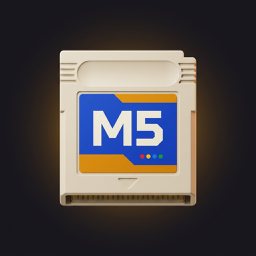
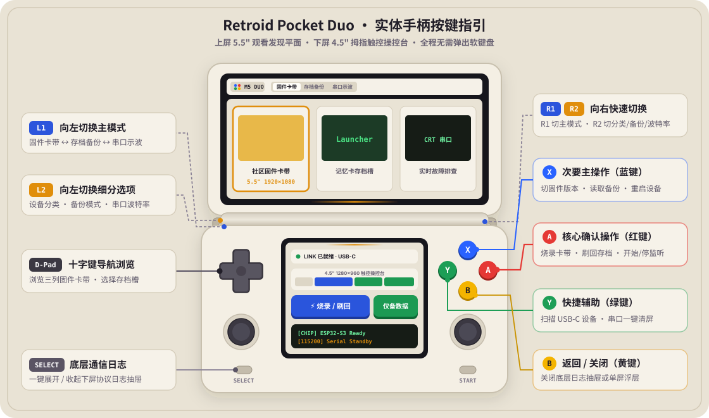

<p align="center">
  
</p>

<h1 align="center">M5Burner Duo</h1>

<p align="center">
  <b>专为 Retroid Pocket Duo 打造的原生双屏 Android M5Stack 在线烧录、固件备份与串口诊断工具</b>
</p>

<p align="center">
  <a href="README.md">English</a> | <b>简体中文</b>
</p>

<p align="center">
  <a href="https://github.com/sky18Dragon/M5bunberDuo/releases/latest">
    
  </a>
</p>

---

## 下载与安装

1. 前往 [**GitHub Releases**](https://github.com/sky18Dragon/M5bunberDuo/releases/latest) 页面，下载最新版的 `M5BurnerDuo-v*.apk`。
2. **在 Retroid Pocket Duo 上直接安装**：用掌机自带浏览器下载后，在「文件管理」中点击 `.apk` 安装（首次安装按提示允许「安装未知应用」即可）。
3. **或通过电脑 ADB 安装**：
   ```bash
   adb install -r M5BurnerDuo-v1.0.0.apk
   ```
4. 使用支持数据传输的 **USB-C 数据线（或 OTG 转接头）** 将 M5Stack 设备接入 Retroid Pocket Duo 的 USB-C 接口，弹窗提示 USB 权限时点击「允许」即可在线烧录、备份或开启串口监视。

---

## 项目简介

**M5Burner Duo** 将 [burner.m5stack.com](https://burner.m5stack.com/) 的在线固件生态带到了掌机端，让你无需电脑，一根 USB-C 数据线即可随时烧录、备份与排查 M5Stack 设备。由于移动端浏览器不支持 WebSerial，本项目使用纯 Kotlin 原生实现了 Espressif ESP32 ROM Bootloader 与 Flasher Stub 的完整 SLIP 烧录/回读协议。

应用采用**复古游戏机风（Retro Handheld Console）**设计，默认**实时跟随 Android 系统浅色/深色开关自动切换**（浅色为与机身融为一体的 **SFC 复古米白**，深色为护眼的 **暗夜复古 CRT**），并按双屏物理示能清晰分工：

- **上屏（5.5" 1920×1080，16:9，120Hz）— 观看与发现平面**：全屏沉浸式浏览社区固件卡带、记忆卡存档槽与宽屏复古荧光 CRT 串口日志。
- **下屏（4.5" 1280×960，4:3，120Hz）— 触控与操控甲板**：通过 Android `DisplayManager` + `Presentation` 原生驱动（单屏设备自动回退为浮层控制台），将立体 3D 按键、USB 硬件心跳桥与实时「闪存分区可视化意符条」放在左右拇指之间。

---

## 核心功能

### 1. 固件卡带（在线浏览与烧录）
- 直连 M5Burner 在线目录（`m5burner-api.m5stack.com`）与固件 CDN（`m5burner-cdn.m5stack.com`），支持本地 JSON 与 `.bin` 离线缓存。
- 支持按设备家族筛选（Cardputer、StickC / Plus2、StickS3、Core、Core2 & Tough、CoreS3、Atom、AtomS3、M5Paper、M5Dial、Tab5、NanoC6 等）、关键字搜索、排序与多版本切换。
- 支持 **zlib 压缩高速烧录（`FLASH_DEFL_*`）**、最高 `1500000` 波特率、自定义偏移地址（`0x0` / `0x10000`）、4MB 擦除及烧录后自动硬件复位。

### 2. 存档备份（固件与存储数据完整管理）
- **自动全片备份（默认）**：自动探测引导头与 `0x8000` 分区表，精准识别芯片真实 Flash 容量（4MB / 8MB / 16MB），将 **App 固件 + NVS 配置 + LittleFS / SPIFFS / FATFS 存储数据** 一并完整回读并做硬件 MD5 校验。
- **仅备数据（极速 `.zip`）**：跳过数 MB 的 App 固件本体，几秒内只读出 `NVS / LittleFS / SPIFFS / FATFS` 等用户数据分区，连同偏移清单 `manifest.json` 压缩打包保存。
- **双模式无损恢复**：支持「**完整刷回**（整机状态还原）」与「**仅恢数据**（保留当前新版固件，只把 NVS/文件系统数据按原偏移写回）」。
- **可视与便携管理**：下屏内置实时联动的 **`[BOOT] [APP固件] [NVS配置] [FS数据]` 闪存地图条**；支持分区标签透视、重命名备注、本地 `.bin` 导入以及一键导出 `.bin` / `.zip` 到掌机本地或 microSD/TF 卡。

### 3. 串口示波（随时接入排查问题）
- 上屏全宽复古深绿荧光 CRT 终端，支持时间戳、关键字实时过滤、Error/Panic 自动标红、暂停/继续与自动滚屏。
- 下屏提供实时信号计数条（`RX 行数 / ERR 计数 / 波特率`）、`9600 / 74880 / 115200 / 921600` 波特率快切、硬件重启（`RST`）、常用调试快捷发送（`回车 / help / status / reboot`）及自定义指令发送。

---

## Retroid Pocket Duo 实体手柄按键映射

所有手柄按键均在 `dispatchKeyEvent` 层统一拦截，浏览固件与切换菜单时不会误触弹出虚拟键盘。

<p align="center">
  
</p>

| 实体按键 | 固件卡带 | 存档备份 | 串口示波 |
| :--- | :--- | :--- | :--- |
| **L1 / R1** | 切换三大核心模式 | 切换三大核心模式 | 切换三大核心模式 |
| **L2 / R2** | 切换 M5Stack 设备分类 | 切换备份模式（自动全片 / 仅备数据 / 4M / 8M / 16M） | 切换串口波特率 |
| **十字键 D-Pad** | 浏览三列固件卡带 | 选择记忆卡存档槽 | 左右切换波特率 |
| **A（红键）** | 下载并烧录选中固件 | 完整刷回 / 恢复数据分区 | 开始 / 停止监听 |
| **X（蓝键）** | 切换固件版本 | 读取并备份当前设备 | 发送硬件复位（RST） |
| **Y（绿键）** | 扫描 USB-C OTG 设备 | 扫描 USB-C OTG 设备 | 清空串口屏幕 |
| **Select** | 开关底层协议日志 | 开关底层协议日志 | 开关底层协议日志 |

---

## 支持的芯片与 USB 串口桥接

- **Espressif 芯片**：ESP32、ESP32-S2、ESP32-S3、ESP32-C2、ESP32-C3、ESP32-C6、ESP32-H2、ESP32-P4（内置官方轻量级 Flasher Stub 支持高速 `READ_FLASH` 备份）。
- **USB-C OTG 芯片**：
  - Espressif 原生 USB-Serial/JTAG CDC-ACM（`0x303A`：Cardputer、CoreS3、AtomS3、StickS3、Dial、Tab5、NanoC6）
  - WCH CH9102F / CH340 / CH341（`0x1A86`：Core2 v1.1、StickC Plus2、Atom、Paper、CoreInk）
  - Silicon Labs CP210x（`0x10C4`：Core、Core2、StickC、Tough）
  - FTDI FT232（`0x0403`）

---

## 代码结构

```text
app/src/main/
├── assets/stubs/                    # Espressif 官方 RAM Flasher Stub（esp32/s2/s3/c2/c3/c6/h2）
├── java/com/m5burner/duo/
│   ├── MainActivity.kt              # 上屏主 Activity、全屏沉浸模式、系统主题同步与手柄拦截
│   ├── SecondaryDeckPresentation.kt # 下屏 4.5" AMOLED DisplayManager Presentation
│   ├── data/
│   │   ├── M5BurnerRepository.kt    # 在线目录 API 拉取与 CDN 固件缓存
│   │   ├── BackupVaultRepository.kt # 存档库管理、分区元数据记录与 SAF 导出
│   │   └── model/FirmwareModels.kt  # M5Burner 接口与烧录参数模型
│   ├── flasher/
│   │   ├── EspSlipProtocol.kt       # SLIP 帧编解码与 ROM / Stub 协议包构造
│   │   ├── EspFlasherEngine.kt      # 在线烧录、自动全片备份、仅数据备份/恢复与串口监视
│   │   ├── EspPartitionTable.kt     # 0x8000 分区表与引导头容量解析器
│   │   ├── DataBackupBundle.kt      # .zip 纯数据多分区打包与解包器
│   │   └── UsbSerialController.kt   # Android USB OTG 探测与权限管理
│   └── ui/
│       ├── M5BurnerViewModel.kt     # 双屏共享统一状态层
│       ├── TopCatalogScreen.kt      # 上屏 5.5" 卡带架 / 记忆卡存档 / CRT 终端
│       ├── BottomDeckScreen.kt      # 下屏 4.5" 触控操控台与闪存分区地图条
│       ├── RetroComponents.kt       # 3D 复古按键、微透玻璃键帽与跨转轴光带
│       └── theme/Theme.kt           # SFC 复古米白（浅色）与暗夜 CRT（深色）双主题
└── res/xml/device_filter.xml        # M5Stack 全系 USB-C OTG VID/PID 过滤器
```

---

## 编译与安装

### 环境要求
- Android SDK（`compileSdk = 36` / `targetSdk = 36`，`minSdk = 28`）
- JDK **17+** 与 Gradle **9.3+**

### 构建命令

```bash
# 运行全部单元测试（SLIP 协议、分区表解析、纯数据 zip 打包与 API 解析）
./gradlew testDebugUnitTest

# 编译 Debug APK
./gradlew assembleDebug

# 通过 ADB 安装到 Retroid Pocket Duo
adb install -r app/build/outputs/apk/debug/app-debug.apk
```

---

## 致谢

- [M5Stack M5Burner](https://burner.m5stack.com/) 提供的开源社区固件生态。
- [usb-serial-for-android](https://github.com/mik3y/usb-serial-for-android) 提供的 Android USB Host 串口驱动库。
- [Espressif esptool](https://github.com/espressif/esptool) 提供的开源 Flasher Stub 与串行烧录协议参考。
